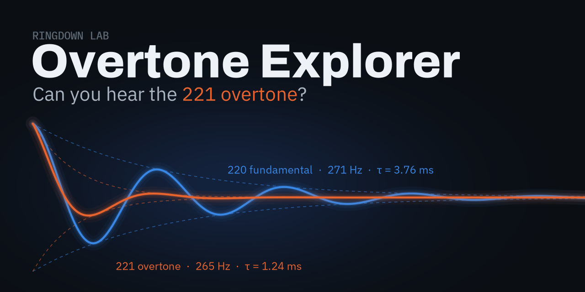

# Overtone Explorer

**Open it: https://leonardoperugia09-cyber.github.io/overtone-explorer/**

An interactive page that answers one question about a ringing black hole:
**can you hear the 221 overtone?**

Open `index.html` in any web browser. No installation needed.

Move the sliders (mass, spin, overtone amplitude and phase, loudness, fit start time)
and the page works out, from the physics, whether the overtone can be detected in
noisy data, and explains why. Blue is the 220 fundamental, orange the 221 overtone.

Physics: Berti, Cardoso & Will (2006) fits for the mode frequencies and damping times,
white Gaussian noise, least-squares fits and Fisher-matrix errors.

Part of the Ringdown Lab TKS Focus Project by Leonardo Perugia, 2026.

## License

MIT © 2026 Leonardo Perugia
